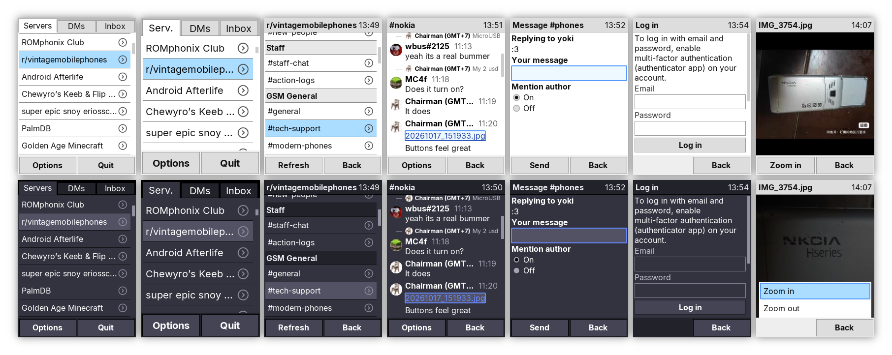

# 

Microcord is a new Discord client for Java devices, currently in development. Its goal is to be an evolution of [Discord J2ME](https://github.com/gtrxAC/discord-j2me) and [Droidcord](https://github.com/leap0x7b/Droidcord) with a focus on proxyless connectivity, user-friendly UI, and maintainability.

> [!IMPORTANT]
> **Microcord is not yet a fully featured replacement for Discord J2ME.**
>
> It lacks some features of Discord J2ME (like emojis) but also has some features not present in Discord J2ME (like the inbox).

This repo is for the J2ME version. There is a separate repo for the [Android version](https://github.com/gtrxAC/Microcord-Android), but the plan is to eventually merge these into one project and potentially add support for other Java-based platforms like desktop.

## Status
### Working
* Password/token login
* Multiple accounts
* Main menu with servers, DMs, inbox
* Channel list with categories
* Chat screen with pagination, avatars, replies, timestamps
* Sending messages and replies
* Viewing attachments
* Message editing and deleting
* Settings for theme, message count, etc.
* Bluetooth tethering (BlueWAP)

### Planned for later
* Threads
* Forums
* Emojis
* Reactions
* Embeds
* Text formatting with [nnmarkdown](https://github.com/shinovon/nnmarkdown)
* Custom themes
* Languages
* Unread indicators

### Not planned
* Gateway (not practical without a proxy, which is unsafe)
* Sending attachments (unsafe for third-party clients)
* Friend requests (unsafe)
* Joining servers (unsafe)

## Why another Discord J2ME?
In 2024, I started Discord J2ME as my first big Java project. Throughout those two years, several new features have been added to it, and many new things have been discovered along the way, such as Discord's anti-spam measures, and ways to get HTTPS (TLS) connectivity on J2ME devices.

Discord J2ME's codebase has gotten too difficult to manage, and bugs in the client have become increasingly difficult to fix. Discord J2ME was built on false assumptions, like proxies being safe to use, and the system UI being consistent across devices.

Due to this, and the lack of a good Discord client for legacy Android, I decided to start fresh with Microcord. The goal was to build a new client to fix many of Discord J2ME's shortcomings from the very beginning.

**Microcord's main focuses are:**

* **Proxyless connectivity**
  * reduces the risk of account restrictions
* **User-friendly setup and UI**
  * no cluttered menus
  * more descriptive error messages
  * overall less confusion, leading to less support requests
* **Maintainability**
  * clean code
  * less build variants to maintain (midp2, midp2_alt, samsung, etc.)

## Officially supported devices
Any device meeting the [system requirements](#system-requirements) should be able to run the app, but technical support will mainly be provided for these officially supported devices, and the app will be developed mainly with them in mind.
* Symbian devices with the [nnproject TLS patch](https://nnproject.cc/tls/) installed
* Sony Ericsson devices with DB2020 chipset or newer
  * This includes most devices from 2006 onwards; check your device [here](https://lpcwiki.miraheze.org/wiki/Sony_Ericsson_platform#List_of_phones)
  * Data cable is required
  * Newer DB2010 devices may also work well (e.g. W300, W810, Z530)
* Nokia devices running Series 40 3rd Edition FP1 or later
  * TLS on these phones is quite CPU-intensive, so it's recommended to find one with a faster CPU or use a Symbian/Sony Ericsson device instead
  * Low-end devices with Series 40 Lite (DCT4 platform) are not supported

## System requirements
| Specification | Minimum | Recommended |
|-|-|-|
| **Java ME support** | MIDP 2.0, CLDC 1.0 | MIDP 2.0, CLDC 1.0
| **Extra APIs** | none | JSR-75 FileConnection JSR-82 Bluetooth API
| **JAR size limit** | 200 kB (may increase) | 1 MB
| **Heap size (RAM)** | 1 MB (may increase) | 2 MB
| **Display** | any color/grayscale screen | 128 × 160 or higher
| **Others** | none | TLS 1.2 support

## For developers
The build system is based on my [j2me-template](https://github.com/gtrxAC/j2me-template/).
